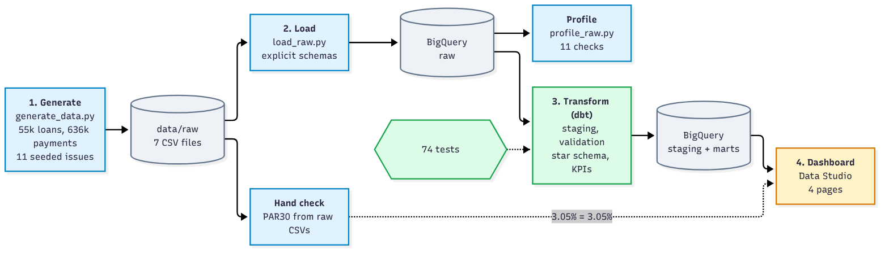
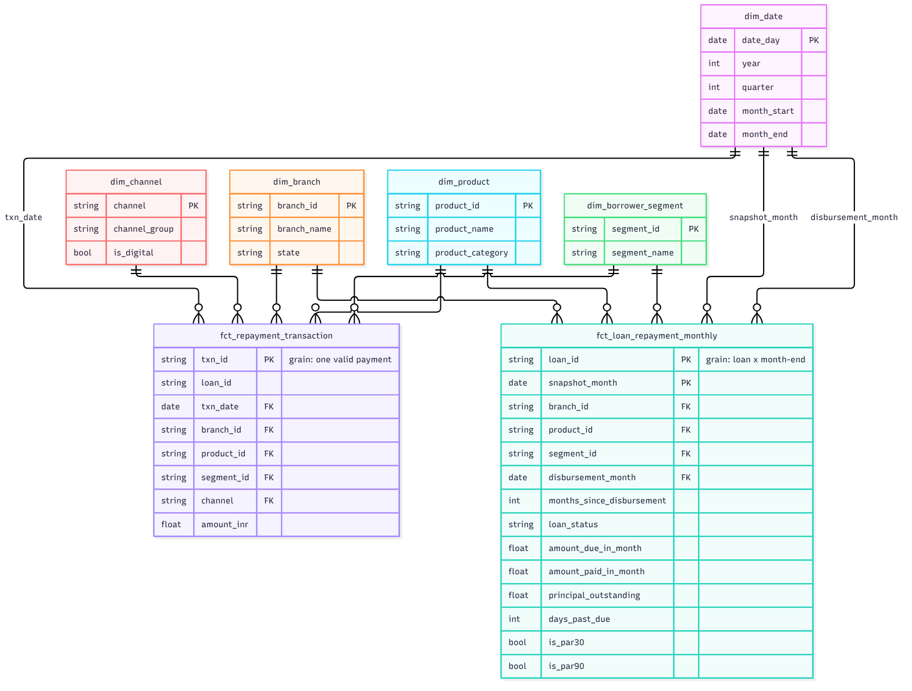
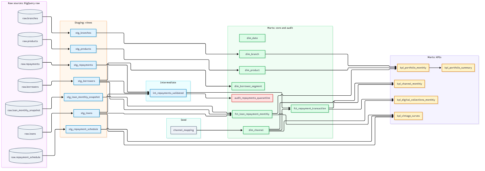
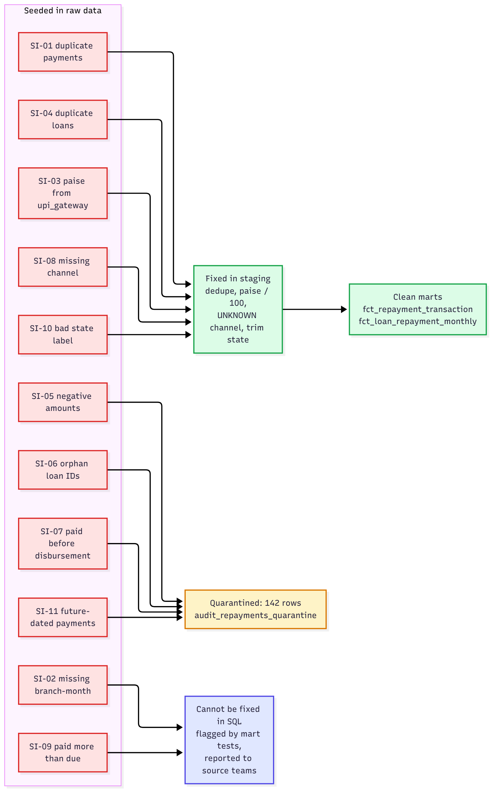

# Financial Inclusion Analytics Warehouse

An end-to-end analytics warehouse for a microfinance loan book: synthetic data with
deliberately seeded problems, profiling, a dbt star schema on BigQuery, 74 automated
data-quality tests, portfolio and collections KPIs, and a 4-page dashboard.

**Live dashboard:** [Google Data Studio (Looker Studio) report](https://datastudio.google.com/reporting/20f1119e-e10a-46f5-bfea-e06c7b12302b)
(PDF and screenshots in [`docs/dashboard/`](docs/dashboard/))

## Headline results (as of 30 June 2026)

| KPI | Value |
|---|---|
| Gross loan portfolio | ₹136.7 crore across 37,513 active loans |
| PAR30 / PAR90 | 3.05 % / 1.23 % |
| Collection efficiency (June 2026) | 95.71 % |
| Digital share of collections | 77.27 % by value (+16.05 pp year on year) |
| Riskiest state / product | Bihar (PAR30 4.52 %) / Kisan Crop Loan (PAR30 6.02 %) |

## Architecture



| Layer | Tool | Why |
|---|---|---|
| Data generation | Python, Polars, NumPy | Full control over realistic repayment behaviour; fixed seed makes every run identical |
| Warehouse | BigQuery (sandbox) | Serverless, free tier, native connector to the dashboard |
| Transformation and tests | dbt Core 1.12 + dbt_utils | Version-controlled SQL models, lineage, tests next to the models |
| Dashboard | Google Data Studio (Looker Studio) | Reads BigQuery directly; shareable link |

## Deliverables

| Requirement | Where |
|---|---|
| Data generator | [`generator/generate_data.py`](generator/generate_data.py), assumptions in [`config.yaml`](generator/config.yaml) |
| Load scripts | [`load/load_raw.py`](load/load_raw.py) |
| Profiling before modelling | [`profiling/profile_raw.py`](profiling/profile_raw.py) → [`profiling_report.md`](profiling/profiling_report.md) |
| List of seeded problems | [`generator/seeded_issues.yaml`](generator/seeded_issues.yaml) |
| Which problems the tests caught | [`docs/test_results.md`](docs/test_results.md) |
| Star schema diagram and grain | [`docs/schema.md`](docs/schema.md), [`docs/diagrams/`](docs/diagrams/) |
| SQL / dbt models | [`dbt_project/models/`](dbt_project/models/) (staging → intermediate → marts/core, marts/kpi) |
| 20+ automated tests | 74 tests: [`_sources.yml`](dbt_project/models/staging/_sources.yml), [`_staging.yml`](dbt_project/models/staging/_staging.yml), [`_core.yml`](dbt_project/models/marts/core/_core.yml), [`_kpi.yml`](dbt_project/models/marts/kpi/_kpi.yml), [`tests/`](dbt_project/tests/) |
| KPI definitions (one page) | [`docs/kpi_definitions.md`](docs/kpi_definitions.md) |
| Dashboard | [Live link](https://datastudio.google.com/reporting/20f1119e-e10a-46f5-bfea-e06c7b12302b), [`docs/dashboard/`](docs/dashboard/) |
| Hand check of one KPI | [`hand_check/hand_check_par30.py`](hand_check/hand_check_par30.py) → [`hand_check_result.md`](hand_check/hand_check_result.md) |
| Write-up | [`docs/write_up.md`](docs/write_up.md) |

## Data model

Two fact tables share five dimensions. Grain decisions are explained in [`docs/schema.md`](docs/schema.md).

* **`fct_loan_repayment_monthly`**: one row per loan per month-end (PAR, collection efficiency, vintage)
* **`fct_repayment_transaction`**: one row per valid, de-duplicated payment (digital share, channels)
* Dimensions: `dim_date`, `dim_branch` (state > branch), `dim_product`, `dim_borrower_segment`, `dim_channel`



## dbt lineage

Generated from dbt's own dependency graph (`target/manifest.json`): 7 raw sources and 1 seed flow
through 7 staging views and 1 validation model into 8 core/audit tables and 5 KPI tables.



## How seeded problems are handled



Diagram sources (Mermaid) are in [`docs/diagrams/`](docs/diagrams/), next to the PNGs.

## How to run

Prerequisites: Python 3.10+, Git, a Google Cloud project with BigQuery datasets `raw`, `staging`
and `marts` in `asia-south1`, and the gcloud CLI signed in
(`gcloud auth application-default login`).

```bash
python -m venv .venv
.venv\Scripts\activate                   # macOS/Linux: source .venv/bin/activate
python -m pip install -r requirements.txt

python generator/generate_data.py        # 1. generate data (about 5 s, same output every run)
python load/load_raw.py                  # 2. load CSVs into BigQuery `raw`
python profiling/profile_raw.py          # 3. profile raw data
cd dbt_project
dbt deps                                 # 4. install dbt_utils
dbt build                                # 5. seed, build 21 models, run 74 tests
cd ..
python scripts/test_report.py            # 6. test report with seeded-issue coverage
python hand_check/hand_check_par30.py    # 7. independent PAR30 check from raw CSVs
```

Set `GCP_PROJECT` if your project ID is not `fin-inclusion-dwh`, and point the `dbt_project`
profile in `~/.dbt/profiles.yml` at the same project (method `oauth`, location `asia-south1`).

**Windows note:** if Smart App Control blocks `dbt.exe`, use the included `dbt.bat`
(`..\dbt build` from inside `dbt_project`), which runs dbt through Python.

**Expected `dbt build` result:** `PASS=83 WARN=13 ERROR=0`. The 13 warnings are tests catching
the seeded problems, see [`docs/test_results.md`](docs/test_results.md).

## Notes

* All data is invented. Branch towns are real place names; people, loans and amounts are not.
* BigQuery sandbox tables expire after about 60 days. Re-run steps 1–5 to rebuild the warehouse
  if the live dashboard shows no data.
