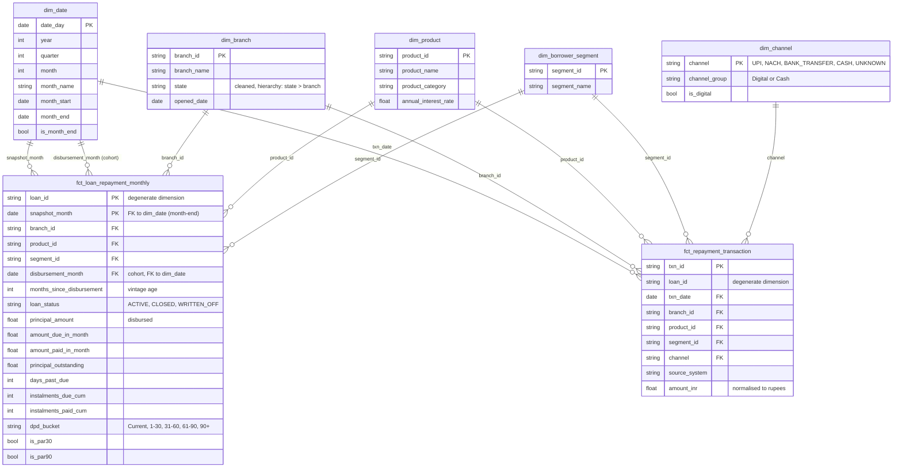

# Star Schema Design

The warehouse has **two fact tables** sharing **five conformed dimensions**.
Dimensions are used by both facts, so a branch, product or month means exactly the
same thing whether you analyse portfolio risk or payment channels.

## Diagram

## Grain of each table

| Table | Grain: one row per… | Source (raw) | Used for |
|---|---|---|---|
| `fct_loan_repayment_monthly` | **loan per calendar month-end**, from the disbursement month until the loan closes, is written off, or the as-of date | `loan_monthly_snapshot` + `loans` + `borrowers` | PAR30, PAR90, collection efficiency, vintage curves |
| `fct_repayment_transaction` | **valid, de-duplicated payment transaction** | `repayments` + `loans` + `borrowers` | Digital share, MoM / YoY growth, average payment size by channel |
| `dim_date` | calendar day | generated | All time analysis |
| `dim_branch` | branch (state is an attribute) | `branches` | State and branch breakdowns |
| `dim_product` | loan product | `products` | Product breakdowns |
| `dim_borrower_segment` | borrower segment | `borrowers` | Segment breakdowns |
| `dim_channel` | payment channel | generated from `repayments` values | Digital vs cash split |

## Grain decisions and why

**1. Repayment fact is monthly per loan, not per instalment.**
PAR and collection efficiency are *month-end portfolio* measures: "how much
outstanding principal is more than 30 days overdue on 31 March?". Days past due
and outstanding principal are *states of a loan at a point in time*, which fit a
monthly snapshot naturally. An instalment-level fact would need re-aggregating
for every KPI and has no natural place for outstanding balance. The month also
lines up with vintage analysis (months since disbursement) and with the source
system, which reports at month-end. The instalment schedule stays in staging,
where it is used for tests.

**2. Transactions are a separate fact, not columns on the monthly fact.**
Transactions and monthly snapshots have different grains: a loan has one row
per month, but can have zero, one or several payments in that month. Joining
them directly would multiply rows and inflate totals (a fan-out). Keeping two
facts at their natural grain, joined only through shared dimensions, avoids
double counting. Channel analysis also needs individual payments: average
payment size cannot be computed from monthly totals.

**3. State lives inside `dim_branch` (star, not snowflake).**
There are only 6 states and 30 branches. A separate state table would add a
join without adding information. The state > branch hierarchy is two columns on
one table, which also makes the dashboard drill-down simple.

**4. Loan ID is a degenerate dimension.**
Loan attributes that matter for analysis (product, segment, branch, disbursement
month, principal) are already on the fact as keys or columns. A separate
`dim_loan` would be as big as the fact itself and add nothing.

**5. Natural keys instead of surrogate keys.**
Branch, product, segment and channel IDs are stable codes from the source, and
the dimensions do not change over time (no slowly changing dimensions needed),
so the source IDs are used directly. This keeps the models readable and makes
the hand-check in Stage 8 easier to trace back to raw data.

**6. `dim_channel` is an extra dimension.**
The task lists four dimensions. A small channel dimension is added because
"digital" is a business rule (everything except cash). Defining it once in a
table means every KPI uses the same definition. Rows with a missing channel map
to an `UNKNOWN` member, so they are counted in totals but kept out of both the
digital and cash shares instead of silently disappearing in a join.

**7. Disbursement month is a second (role-playing) date key.**
The same `dim_date` is used twice on the monthly fact: once for the snapshot
month and once for the cohort (disbursement month). That is what vintage
curves need: rows grouped by cohort and plotted against months since
disbursement.

## How seeded problems affect the design

| Issue | Where it is handled |
|---|---|
| SI-01 duplicate transactions, SI-04 duplicate loans | Staging de-duplicates, so fact grain stays one row per key |
| SI-03 paise amounts | Staging converts to rupees; fact column is named `amount_inr` to make the unit explicit |
| SI-05, SI-06, SI-07, SI-11 invalid payments | Excluded from `fct_repayment_transaction` (kept in a quarantine model for audit) |
| SI-08 missing channel | Mapped to `UNKNOWN` in `dim_channel` |
| SI-10 bad state label | Cleaned in `dim_branch` |
| SI-02 missing month, SI-09 paid > due | Cannot be fixed by transformation; detected by tests and reported |
